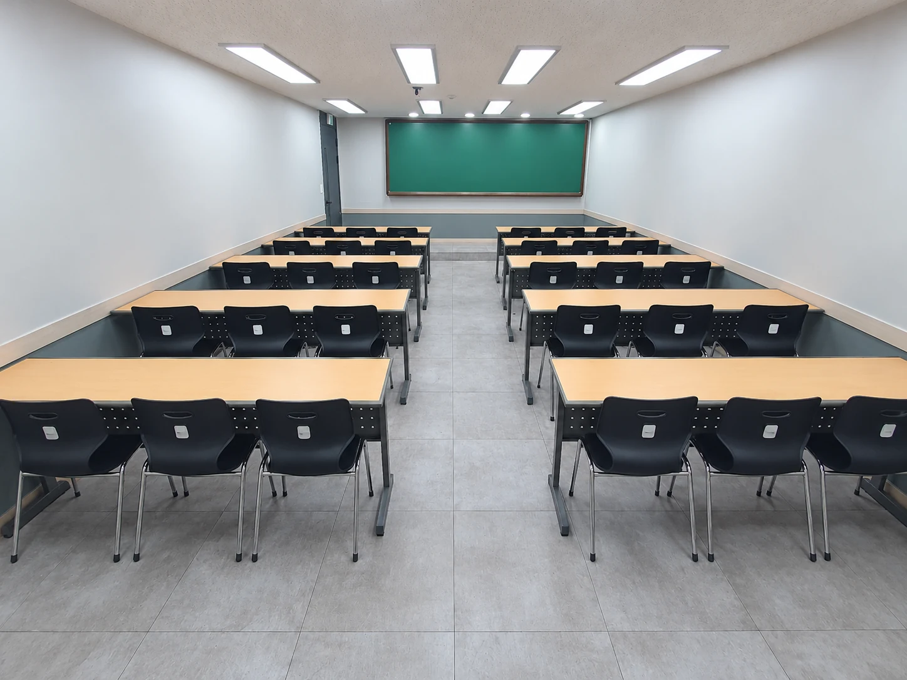

모임을 준비하다 보면 "책상은 어떻게 놓으세요?"라는 질문을 받게 됩니다. 배치를 부르는 이름이 공간마다 조금씩 달라서, 같은 모양을 두고도 말이 엇갈리기 쉽습니다. 소셜팩토리 건대에서는 배치를 다섯 가지 이름으로 부릅니다. 예전에 쓰던 이름도 함께 적었습니다.

## 책상 강의형 (예전 이름 III자형)

책상을 앞쪽 화면이나 칠판을 향해 여러 줄로 놓는 배치입니다. 학교 교실을 떠올리면 됩니다. 노트북을 쓰거나 필기를 많이 하는 수업, 자격증 강의, 직무 교육처럼 듣는 시간이 긴 모임에 맞습니다.

가운데 통로를 하나 두면 강사가 자리 사이를 오가며 질문을 받기 편합니다. 책상이 들어가는 만큼 앉을 수 있는 인원은 의자만 놓을 때보다 줄어든다는 점을 기억해 두세요.

## 의자 강의형 (예전 이름 노테이블형)

책상 없이 의자만 화면을 향해 놓는 배치입니다. 같은 방에 가장 많은 사람이 앉을 수 있어 강연, 설명회, 북토크, 상영회처럼 듣고 보는 모임에 잘 맞습니다. 대신 필기나 노트북 사용이 불편하니, 참가자가 무언가를 써야 하는 순서가 있다면 미리 고려해 주세요.

소셜팩토리 건대에서는 천장이 3.12m로 높은 5번룸과 가장 넓은 4번룸이 이 배치에 잘 어울립니다.

## 조별형 (예전 이름 아일랜드형)

테이블 두세 개를 붙여 섬처럼 여러 모둠을 만드는 배치입니다. 팀별 토론, 워크숍, 원데이클래스, 팀빌딩처럼 참가자끼리 이야기하고 손을 움직이는 모임에 맞습니다. 모둠 사이를 사람이 지나다닐 수 있도록 통로를 넉넉히 두는 것이 중요합니다.

조별형은 공간을 가장 많이 차지하는 배치이기도 합니다. 소셜팩토리 건대에서는 룸 다섯 개 중 가장 넓은 4번룸(약 67.3㎡)을 조별 활동과 워크숍을 위해 두었고, 1번룸에서도 조별형을 쓸 수 있습니다.

## 회의형 (예전 이름 ㄷ자형 · ㅁ자형)

테이블을 ㄷ자나 ㅁ자로 붙여 모두가 서로 얼굴을 보며 앉는 배치입니다. 회의, 토론, 면접, 소규모 세미나에 맞습니다. ㄷ자로 놓으면 열린 쪽에 화면을 두고 발표와 토론을 함께 할 수 있습니다. 화면을 같이 봐야 한다면 좌석 방향을 미리 확인해 주세요.

최대 {{rate.r3.max}}명이 쓰는 3번룸은 처음부터 회의형에 맞춘 긴 방이고, 1 · 2 · 4 · 5번룸에서도 ㄷ자 회의형으로 바꿔 쓸 수 있습니다.

## 자유 배치 (예전 이름 자유형 · 원형)

정해진 모양 없이 가구를 한쪽으로 밀어 활동 공간을 만들거나, 의자를 둥글게 놓는 방식입니다. 소규모 네트워킹, 둘러앉는 독서모임, 몸을 움직이는 프로그램에 씁니다. 옮길 수 있는 가구와 복구 기준을 미리 확인하고 쓰는 것이 좋습니다.

## 룸별로 쓸 수 있는 배치

| 룸 | 최대 인원 | 쓸 수 있는 배치 |
| --- | --- | --- |
| 1번룸 | {{rate.r1.max}}명 | 책상 강의형 · ㄷ자 회의형 · 의자 강의형 · 조별형 |
| 2번룸 | {{rate.r2.max}}명 | 의자 강의형 · 책상 강의형 · ㄷ자 회의형 · 자유 배치 |
| 3번룸 | {{rate.r3.max}}명 | 책상 강의형 · 회의형 |
| 4번룸 | {{rate.r4.max}}명 | 조별형 · 회의형 · 책상 강의형 · 의자 강의형 · 자유 배치 |
| 5번룸 | {{rate.r5.max}}명 | 의자 강의형 · 책상 강의형 · ㄷ자 회의형 |

최대 인원은 방마다 정해진 상한이며, 배치에 따라 실제로 앉을 수 있는 인원은 달라집니다. 룸별 배치 사진은 [공간 안내](/space#layouts)에서 볼 수 있고, [3D 둘러보기](/tour)에서는 강의형 · 워크숍형 · 회의형 배치를 방 안에서 비교해 볼 수 있습니다.

## 배치를 바꿀 때 알아 둘 것

소셜팩토리 건대는 상주 직원 없이 운영해서, 배치는 이용자가 직접 바꾸고 퇴실 전에 원래대로 돌려놓습니다. 시작 전에 처음 배치를 사진으로 찍어 두면 정리가 빠르고, 배치를 바꾸는 시간까지 예약에 넣어 두면 당일이 여유롭습니다.

원하는 배치와 인원을 예약 전에 알려 주시면 그 방에서 가능한지 먼저 확인해 드립니다. [예약 신청](/booking) 화면에서 방을 고를 때 진행 방식도 함께 적어 주세요.
