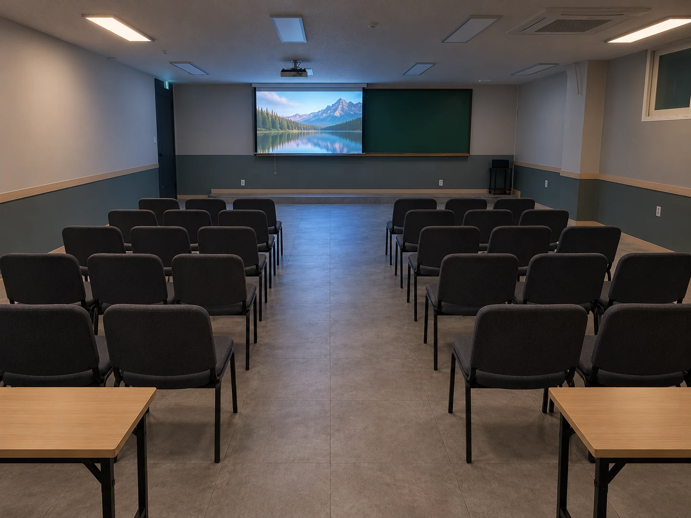

뒷줄에서 슬라이드 글자가 보이지 않거나, 열 명이 노트북 화면 하나를 보려고 의자를 끌고 모이는 장면은 낯설지 않습니다. 빔프로젝터와 대형 모니터는 잘 맞는 모임이 서로 달라서, 방을 고를 때 화면도 함께 봐야 합니다. 소셜팩토리 건대의 룸 다섯 개를 예로 들어 화면 기준으로 방 고르는 법을 정리했습니다.

## 화면 방식은 인원과 앉는 방향이 정합니다

빔프로젝터는 앞쪽 스크린에 크게 띄우는 방식이라, 모두가 한 방향을 보고 앉는 강연과 세미나에 맞습니다. 대형 모니터는 화면이 작은 대신 가까이에서 선명하게 보입니다. 마주 앉아 문서를 함께 보며 고치는 회의나 스터디라면 모니터 쪽이 편합니다.

| 이런 모임이라면 | 맞는 화면 | 소셜팩토리 건대에서 |
| --- | --- | --- |
| 앞을 보고 듣는 강연 · 세미나 | 빔프로젝터 | 2번룸(최대 {{rate.r2.max}}명) · 5번룸(최대 {{rate.r5.max}}명) |
| 강의와 조별 활동이 섞인 워크숍 | 빔프로젝터 | 4번룸(최대 {{rate.r4.max}}명) |
| 영상 상영, 사진 · 작품 리뷰 | 빔프로젝터 | 5번룸 · 4번룸 |
| 문서를 같이 보며 고치는 회의 · 스터디 | 대형 모니터 | 3번룸(최대 {{rate.r3.max}}명) |
| 화면을 보고 따라 하는 실습 수업 | 대형 모니터 | 1번룸(최대 {{rate.r1.max}}명) |

2 · 4 · 5번룸에는 빔프로젝터와 칠판, 1번룸에는 대형 모니터와 칠판, 3번룸에는 대형 모니터와 칠판, 화이트보드가 있습니다. 화면 장비는 기본으로 갖춰져 있어 따로 내는 장비 사용료가 없습니다. 룸별 장비 표는 [공간 안내의 장비 항목](/space#equipment)에서 한눈에 볼 수 있습니다.

## 빔프로젝터 방은 멀리서도 함께 보는 자리에 맞습니다

빔프로젝터의 장점은 화면 크기입니다. 뒷줄까지 같은 슬라이드를 봐야 하는 강연이나 여럿이 함께 보는 영상 상영에 유리합니다. 2번룸은 약 52.1㎡로, 의자 강의형이나 책상 강의형으로 놓으면 좌석이 모두 스크린 쪽을 향합니다. 4번룸은 룸 다섯 개 중 가장 넓은 약 67.3㎡라, 앞쪽 스크린으로 강의를 듣고 조별형으로 바꿔 활동을 이어 가는 워크숍에 쓰기 좋습니다.

5번룸은 천장 높이가 3.12m로 다른 방보다 높고, 네이비 벽에 스크린이 걸려 있습니다. 강연이나 소규모 상영회처럼 화면에 시선을 모으는 모임에 어울립니다.

빔프로젝터 화면은 방이 밝을수록 흐려 보입니다. 위 사진처럼 조명을 낮추면 스크린이 또렷해지니, 영상 비중이 크다면 조명 조절 방법을 예약할 때 함께 물어 두세요.

## 대형 모니터 방은 가까이 모여 고치는 자리에 맞습니다

대형 모니터는 밝은 방에서도 화면이 선명합니다. 자료를 띄워 놓고 그 자리에서 고치거나, 여럿이 한 화면을 가리키며 이야기하는 자리에 맞습니다. 3번룸은 가로 6.97m의 긴 방으로, 한쪽 끝에 대형 모니터, 반대쪽 끝에 칠판, 긴 벽 한 면에 화이트보드가 있습니다. 모니터에는 자료를 띄우고 화이트보드에는 나온 의견을 적으면 회의 흐름이 한눈에 보입니다. 자세한 구조는 [3번룸 소개 글](/magazine/room-3-small-meeting-room)에 정리해 두었습니다.

1번룸은 대형 모니터가 이동식 거치대에 올려져 있고, 정면에 칠판이 있습니다. 화면으로 예시를 보여 주고 각자 자리에서 따라 하는 실습 수업과 정기 클래스에 알맞습니다. 다만 최대 {{rate.r1.max}}명이 모두 앉는 강의라면 뒷줄과 화면 사이가 멀어집니다. 이럴 때는 글자를 키운 자료를 준비하고 핵심은 칠판에 함께 적어 두면 좋습니다.

## 발표 자료는 화면에 맞춰 손봅니다

같은 자료라도 어느 화면에 띄우느냐에 따라 보이는 정도가 달라집니다. 방을 정했다면 자료도 그 화면에 맞게 한 번 손봐 두세요.

- **글자는 크게, 한 장에 한 가지.** 뒷줄에서도 읽힐 만큼 글자를 키우고, 한 장에 담는 내용을 줄입니다.
- **배경과 글자의 대비를 분명하게.** 빔프로젝터는 색이 옅게 보이기 쉬워 연한 회색 글자나 파스텔 배경은 잘 읽히지 않습니다.
- **큰 표는 나눠서.** 모니터 앞에서는 읽히던 표도 스크린 뒷줄에서는 뭉개집니다. 꼭 필요한 줄만 남기고 원본은 파일로 따로 공유합니다.
- **영상 소리는 따로 챙기기.** 노트북 스피커로는 방 뒤까지 소리가 닿기 어렵습니다. 스피커는 무료로 빌려 드리니 예약할 때 말씀해 주세요.

소리를 쓰는 상영이라면 시간대도 함께 봅니다. [이용 원칙](/guide#rules)에 따라 22시 이후에는 앰프를 쓸 수 없고, 23시 이후에는 조용한 이용만 가능합니다.

## 발표 전 화면 연결, 이 순서로 확인합니다

연결은 미리 확인할수록 당일 시작이 수월합니다.

1. **예약할 때 연결 단자를 물어봅니다.** 노트북 연결 단자는 예약할 때 확인해 드립니다. 내 노트북과 단자가 다르면 변환 젠더를 챙기고, USB-C 단자만 있는 노트북은 특히 미리 확인합니다.
2. **노트북이 없다면 대여를 함께 신청합니다.** 노트북 대여는 1대 {{cfg.pricing.options.0.price}}원(예약 1건 기준)이고, 다른 옵션과 함께 [이용 요금의 옵션 항목](/pricing#options)에 정리되어 있습니다.
3. **화면 설정을 미리 정합니다.** 발표자 노트를 따로 볼지(확장), 노트북 화면을 그대로 띄울지(복제) 정하고, 집이나 사무실 모니터에 한 번 연결해 연습합니다.
4. **영상과 자료는 노트북에 저장해 둡니다.** 와이파이가 있어도 온라인 영상은 끊길 수 있으니 재생할 파일은 내려받아 둡니다.
5. **알림과 절전을 끕니다.** 발표 중 메신저 알림이나 화면 보호기가 뜨지 않도록 설정합니다.
6. **입실하면 첫 슬라이드와 영상 한 편을 띄워 봅니다.** 뒷줄 자리에 앉아 글자가 읽히는지, 소리가 들리는지 확인합니다.

## 준비 시간까지 넣어 예약하면 당일이 편합니다

연결과 배치에 쓰는 시간도 예약 시간에 들어갑니다. 최소 예약은 {{booking.minHours}}시간이고 인원 추가 요금 없이 룸 단위로 받습니다. 3시간 발표에 앞뒤로 준비 · 정리 30분씩을 더해 4시간을 잡으면 평일 오후 · 저녁 기준으로 이렇습니다.

| 방 · 화면 | 최대 인원 | 4시간 예약 (평일 오후 · 저녁) |
| --- | --- | --- |
| 3번룸 · 대형 모니터 | {{rate.r3.max}}명 | {{= rate.r3.wdStd * 4 }}원 |
| 1번룸 · 대형 모니터 | {{rate.r1.max}}명 | {{= rate.r1.wdStd * 4 }}원 |
| 5번룸 · 빔프로젝터 | {{rate.r5.max}}명 | {{= rate.r5.wdStd * 4 }}원 |
| 2번룸 · 빔프로젝터 | {{rate.r2.max}}명 | {{= rate.r2.wdStd * 4 }}원 |
| 4번룸 · 빔프로젝터 | {{rate.r4.max}}명 | {{= rate.r4.wdStd * 4 }}원 |

오전 시간대와 주말 요금, 옵션을 더한 금액은 [예상 금액 계산](/pricing#estimate)에서 바로 확인할 수 있습니다. 모임 방식과 화면이 정해졌다면 [예약 신청](/booking)에서 방과 날짜를 고르면 됩니다. 어느 방이 맞을지 고민된다면 일자 · 시간 · 인원 · 모임 유형을 [문의](/contact)로 남겨 주세요. 발표 화면과 배치까지 함께 맞춰 안내해 드립니다.
