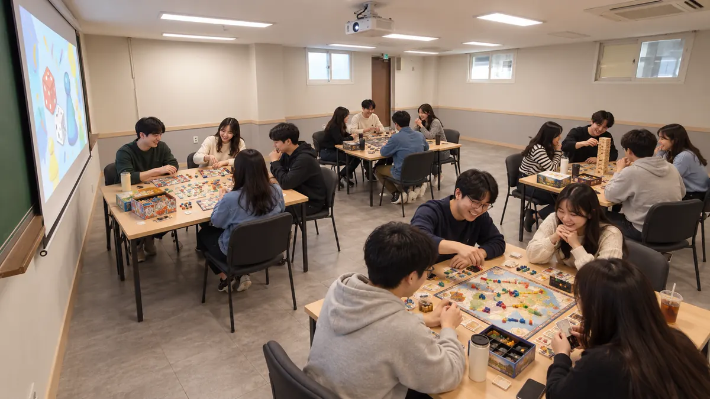

연말 모임을 준비할 때 장소보다 먼저 막히는 것은 '모여서 무엇을 할까'입니다. 저녁을 먹고 2차로 이어지는 송년회가 익숙하지만, 술을 마시지 않는 사람이나 다음 날 일정이 있는 사람에게는 부담이 되기도 합니다. 건대입구에서 세미나실이나 스터디룸을 빌려 바로 해 볼 수 있는 방법을 정리했습니다.

## 술 없는 송년회는 무엇이 다를까

먹고 마시기만 하는 자리에서는 대화가 몇 사람에게 쏠리기 쉽습니다. 게임이나 사진 돌아보기처럼 모두가 같은 것을 하는 모임은 처음 온 사람도 쉽게 섞입니다.

비용을 미리 알 수 있다는 점도 다릅니다. 룸 대관은 인원과 관계없이 방과 시간으로 요금이 정해져, 모이는 인원으로 나누면 1인당 금액이 바로 나옵니다.

소셜팩토리 건대는 건물이 교육환경보호구역 안에 있어 주류를 반입할 수 없습니다. 그래서 처음부터 술 없이 즐기는 순서로 짜는 편이 맞습니다.

## 연말 모임 아이디어 다섯 가지

| 아이디어 | 맞는 방 (최대 인원) | 배치 | 챙길 것 |
| --- | --- | --- | --- |
| 보드게임 팀 대항전 | 4번룸 ({{rate.r4.max}}명) | 조별형 | 보드게임, 점수판 |
| 한 해 사진 · 영상 돌아보기 | 5번룸 ({{rate.r5.max}}명) | 의자 강의형 | 사진 · 영상 파일, 노트북 |
| 브런치 송년회 | 1번룸 ({{rate.r1.max}}명) | ㄷ자 회의형 | 나눠 먹을 음식, 앞접시 |
| 한 줄 회고와 새해 다짐 카드 | 3번룸 ({{rate.r3.max}}명) | 회의형 | 카드, 굵은 펜 |
| 선물 교환과 작은 시상식 | 2번룸 ({{rate.r2.max}}명) | 자유 배치 | 선물, 투표지 |

### 보드게임 팀 대항전

보드게임은 테이블 위에 펼쳐 두는 게임이 많아 조별형 배치가 잘 맞습니다. 4~6명씩 조를 나누고 게임마다 점수를 매겨 마지막에 합산하면, 게임이 바뀌어도 흐름이 끊기지 않습니다. 규칙 설명이 짧은 게임부터 시작하세요. 보드게임은 대여 옵션에 없으니 직접 챙겨 옵니다.

### 한 해 사진 · 영상 돌아보기

각자 올해 찍은 사진을 서너 장씩 미리 모아 슬라이드 한 벌로 만들고, 사진마다 찍은 사람이 한마디를 붙입니다. 5번룸은 천장이 3.12m로 높고 빔프로젝터 스크린이 있어 함께 화면을 보는 모임에 어울립니다. 영상을 튼다면 무료로 빌릴 수 있는 스피커를 함께 신청하세요. 화면 연결은 [발표 화면 고르기 글](/magazine/projector-or-monitor)의 점검 순서를 따르면 됩니다.

### 브런치 송년회

저녁 대신 오전에 모이면 요금도 내려갑니다. 평일 12시 전은 오전 요금이 적용되기 때문입니다. 음식은 각자 한 가지씩 가져오는 방식으로 준비하면 됩니다. 음료 · 다과는 같은 건물 밍글카페 제휴로 신청할 수 있고, 메뉴와 금액은 따로 안내합니다.

### 한 줄 회고와 새해 다짐 카드

'올해 가장 잘한 일 하나'와 '내년에 해 볼 일 하나'를 카드에 적어 돌아가며 읽습니다. 3번룸은 긴 벽에 화이트보드가 있어 카드를 붙여 두기 좋습니다. 팀 회고로 넓히고 싶다면 [연말 팀 회고 KPT 진행표](/magazine/year-end-team-retrospective-kpt)를 참고하세요.

### 선물 교환과 작은 시상식

선물은 금액 상한을 미리 정해 두면 고르는 부담이 줄어듭니다. '올해의 개근상'처럼 가벼운 상을 투표로 정해 마지막 순서에 발표하면 모임이 깔끔하게 닫힙니다. 2번룸과 4번룸은 자유 배치가 가능해 가운데를 비워 둘 수 있습니다.

## 세 시간 진행 순서 예시

보드게임과 사진 돌아보기를 묶어 20명이 토요일 오후 4번룸에 모인다면 이렇게 짤 수 있습니다. 준비와 정리 시간도 예약 시간에 넣습니다.

1. **14:00~14:20 준비** — 조별형으로 테이블 나누기, 화면 연결, 다과 차리기
2. **14:20~14:30 열기** — 끝나는 시각과 순서 안내, 조 나누기
3. **14:30~15:30 보드게임 팀 대항전** — 게임 두세 개, 조별 점수 기록
4. **15:30~15:40 쉬는 시간** — 대화는 휴게 · 대기 공간에서
5. **15:40~16:20 한 해 사진 돌아보기** — 한 사람당 사진 한 장, 한마디
6. **16:20~16:40 시상과 선물 교환** — 팀 점수와 투표 결과 발표
7. **16:40~17:00 정리** — 단체 사진, 배치 원상복구, 퇴실

## 인원별 방 고르기와 비용 계산

요금은 인원 추가 없이 룸 단위로 받고, 예약은 최소 {{booking.minHours}}시간부터 30분 단위로 합니다. 아이디어별로 계산하면 이렇습니다.

| 모임 | 방 · 시간 | 금액 | 1인당 |
| --- | --- | --- | --- |
| 평일 오전 15명 · 브런치 | 1번룸 · 09:30~12:00 | {{= rate.r1.wdEarly * 2.5 }}원 | {{= rate.r1.wdEarly * 2.5 / 15 }}원 |
| 평일 저녁 10명 · 다짐 카드 | 3번룸 · 19:00~21:30 | {{= rate.r3.wdStd * 2.5 }}원 | {{= rate.r3.wdStd * 2.5 / 10 }}원 |
| 평일 저녁 25명 · 사진 돌아보기 | 5번룸 · 19:00~22:00 | {{= rate.r5.wdStd * 3 }}원 | {{= rate.r5.wdStd * 3 / 25 }}원 |
| 토요일 오후 20명 · 보드게임 | 4번룸 · 14:00~17:00 | {{= rate.r4.hdStd * 3 }}원 | {{= rate.r4.hdStd * 3 / 20 }}원 |

올해 12월 25일(금)은 공휴일이라 주말 · 공휴일 요금이, 12월 31일(목)은 평일 요금이 적용됩니다. 날짜와 시간을 넣으면 [예상 금액 계산](/pricing#estimate)에서 시간대별 금액을 바로 볼 수 있습니다. 48명이 넘는 송년회라면 [48명이 넘는 행사 글](/magazine/large-event-over-48)에서 방을 나누는 방법과 같은 건물 2층의 대형 행사장을 함께 살펴보세요.

## 음식 · 소리 · 정리, 미리 정해 둘 것

- **음식**: 음료 · 다과와 식사는 가져올 수 있습니다. 주류는 반입할 수 없으며, 확인되면 이용을 바로 중단하고 환불하지 않습니다.
- **소리**: 22시 이후에는 앰프를 쓸 수 없고, 23시 이후에는 조용한 이용만 가능합니다. 같은 층에 24시간 코워킹 공간과 독립사무실이 있어 복도에서는 목소리를 낮춰 주세요.
- **정리**: 배치는 직접 바꾸고 퇴실 전에 원래대로 돌려놓습니다. 음식을 차리는 모임은 정리 시간을 넉넉히 잡는 편이 좋습니다.

> **연말 일정이 바뀔 때**
> 환불 비율은 이용일이 가까울수록 낮아집니다(취소 기준: {{cfg.pricing.cancel}}). 날짜와 인원이 정해진 뒤 예약하면 마음이 편하고, 자세한 내용은 [환불 기준](/pricing#refund)에서 확인할 수 있습니다.

술을 곁들이는 파티나 생일 모임을 생각하고 있다면 패밀리 브랜드인 무인 파티룸 쏘플파티룸이나 플레이션 게임파티룸 지점을 [패밀리 브랜드 안내](/family)에서 찾아보세요. 지점별 이용 규칙과 예약은 각 홈페이지 안내를 따릅니다.

할 거리와 날짜가 정해졌다면 [예약 신청](/booking)에서 방과 시간을 고르면 됩니다. 인원이나 진행 방식이 아직 애매하다면 일자 · 시간 · 인원 · 모임 유형을 [문의](/contact)로 남겨 주세요.
