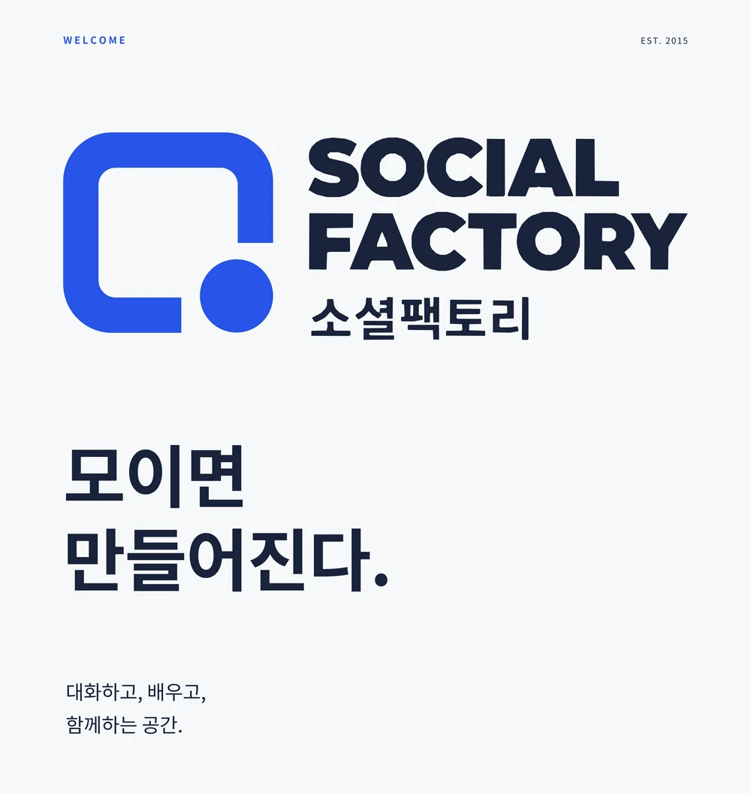

건대입구에서 세미나실이나 스터디룸을 찾다 보면 방 크기와 요금부터 비교하게 됩니다. 슬로건까지 읽을 일은 드뭅니다. 그런데 소셜팩토리의 슬로건 '모이면 만들어진다'는 방을 나누고 요금을 받는 방식과 꽤 가깝게 닿아 있습니다.

이 글은 그 문장이 어디서 왔는지, 지금 소셜팩토리 건대에서 어떤 기준으로 남아 있는지를 다룹니다. 지점이 늘고 문을 닫기까지의 긴 이야기는 [브랜드 스토리](/story)에 따로 정리해 두었습니다.

## 소셜과 팩토리, 이름에서 나온 문장

소셜팩토리는 두 단어를 붙여 지은 이름입니다. 소셜은 사람과 관계를, 팩토리는 무언가를 만들어 내는 곳을 뜻합니다. 이어 읽으면 '사람이 모여 무언가를 만드는 곳'이 되고, 슬로건은 이 생각을 그대로 옮긴 문장입니다.

문장에는 무엇이 만들어지는지가 적혀 있지 않습니다. 공간이 무엇을 만들지는 운영자가 정하지 않기 때문입니다. 스터디가 열리면 함께 공부한 시간이, 클래스가 열리면 작품이, 강연이 열리면 새로 알게 된 사람이 남습니다.

로고도 같은 뜻을 담고 있습니다. 기본 심볼의 열린 사각형은 공간, 그 옆의 점은 사람입니다. 한쪽이 열린 공간은 사람이 들어와야 비로소 완성됩니다. 심볼과 색, 서체 이야기는 [소셜팩토리 소개](/about)에 있습니다.

## 2015년, 빌려주기만 하지 않기로 한 계획

이 문장이 가리키는 운영 방식은 홍대 1호점보다 앞서 정해졌습니다. 그 무렵 최시준 대표는 대학생과 사회초년생을 위한 강연과 네트워킹 파티, 연합동아리 활동을 기획하고 있었습니다. 2015년 7월에는 홍대 스터디카페 상권을 직접 돌아보고 '소셜테이블'이라는 운영계획안을 썼습니다.

계획안의 뼈대는 공간을 빌려주는 데서 그치지 않고 공간 안에서 직접 프로그램을 여는 구조였습니다. 20 · 30대가 시간을 쓰는 이유를 취업, 취미, 소모임으로 나눴고, 그에 맞춰 강연과 클래스, 플리마켓을 열었습니다. 강사와 모임장이 프로그램을 진행하고 소셜팩토리가 공간과 홍보를 맡는 방식은 그 뒤로도 이어졌습니다.

## 모임마다 만들어지는 것이 다릅니다

'만들어진다'를 모임 종류별로 풀어 보면, 끝나고 남는 것과 맞는 방이 함께 보입니다. 소셜팩토리 건대의 룸 다섯 개를 기준으로 정리했습니다.

| 모임 | 끝나고 남는 것 | 맞는 방 · 배치 |
| --- | --- | --- |
| 스터디 · 회의 | 함께 공부한 시간, 정리한 결정 | 3번룸(최대 {{rate.r3.max}}명) 회의형 · 대형 모니터와 화이트보드 |
| 원데이 · 정기 클래스 | 작품, 다음 수업의 약속 | 1번룸(최대 {{rate.r1.max}}명) 책상 강의형 · 조별형 |
| 강연 · 세미나 | 새로 알게 된 사람과 내용 | 2번룸(최대 {{rate.r2.max}}명) 의자 강의형 · 책상 강의형 |
| 워크숍 · 조별 활동 | 조별 결과물과 발표 | 4번룸(최대 {{rate.r4.max}}명) 조별형 · 자유 배치 |
| 동아리 모임 · 상영 | 함께 본 장면과 나눈 이야기 | 5번룸(최대 {{rate.r5.max}}명) 의자 강의형 · 천장 3.12m |

룸별 크기와 사진, 배치별 모습은 [공간 안내](/space#rooms)에서 볼 수 있습니다. 같은 방도 책상과 의자를 옮겨 다른 배치로 쓸 수 있고, 퇴실 전에 원래대로 돌려놓으면 됩니다.

## 문장이 운영 기준이 된 네 가지

슬로건은 포스터에만 있지 않습니다. 소셜팩토리 건대를 운영하는 기준 가운데 몇 가지가 이 문장에서 이어집니다.

1. **인원이 아니라 룸과 시간으로 받습니다.** 최대 인원 안에서는 인원 추가 요금이 없어서, 함께 오는 사람이 늘수록 1인 부담이 줄어듭니다. 3번룸을 평일 오후에 두 시간 쓰면 {{= rate.r3.wdStd * 2 }}원이고, 여섯 명이 와도 {{rate.r3.max}}명이 와도 금액은 같습니다.
2. **한 방을 여러 배치로 씁니다.** 배치는 책상 강의형, 의자 강의형, 조별형, 회의형, 자유 배치 다섯 가지 이름으로 부릅니다. 모임에 맞춰 이용자가 직접 바꾸므로, 같은 방에서 오전에는 강의가, 저녁에는 워크숍이 열릴 수 있습니다.
3. **모임 앞뒤의 시간을 한 층에 둡니다.** 같은 층에 24시간 코워킹 50석과 1~3인 독립사무실 네 실이 있습니다. 세미나 전에 자료를 다듬거나 스터디를 마치고 남아 복습하는 시간까지 한 층에서 이어집니다.
4. **모임을 여는 사람과 함께합니다.** 강사와 호스트, 모임장이 프로그램을 열 수 있도록 공간과 시간, 운영 방식을 함께 맞춥니다. 함께하는 방법은 [프로그램 · 호스트 모집](/program)에 정리해 두었습니다.

## 모임을 준비할 때 던져 볼 질문 세 가지

슬로건을 거꾸로 읽으면 모임 준비에 바로 쓸 수 있는 질문이 됩니다. 무엇을 만들지 먼저 정하면 방과 배치, 시간이 따라 정해집니다.

- **끝났을 때 무엇이 남아야 하나요?** 화면에 띄운 자료를 함께 고쳐야 한다면 대형 모니터가 있는 1번룸이나 3번룸이 편합니다. 판서와 메모가 많다면 칠판과 화이트보드가 모두 있는 3번룸, 여럿이 큰 화면 하나를 봐야 한다면 빔프로젝터가 있는 2 · 4 · 5번룸이 맞습니다.
- **몇 명이 함께 만드나요?** 최대 인원은 배치에 따라 달라집니다. 책상을 쓰는 수업이나 조별 활동이라면 필요한 책상 수와 통로까지 따져서 방을 고릅니다.
- **만드는 데 얼마나 걸리나요?** 진행 시간에 준비와 정리 시간을 더해 예약합니다. 예약은 최소 {{booking.minHours}}시간부터입니다.

세 가지 답이 정리됐다면 [예상 금액 계산기](/pricing#estimate)에 룸과 시간을 넣어 금액을 확인하고 [예약 신청](/booking)으로 이어 가면 됩니다. 방을 고르기 어렵다면 날짜와 인원, 진행 방식을 적어 [문의](/contact)로 보내 주세요. 맞는 방과 예약할 수 있는 시간을 안내해 드립니다. 소셜팩토리가 처음 문을 연 2015년의 기록은 [홍대 1호점 이야기](/magazine/hongdae-first-branch-2015)에서 이어 읽을 수 있습니다.
