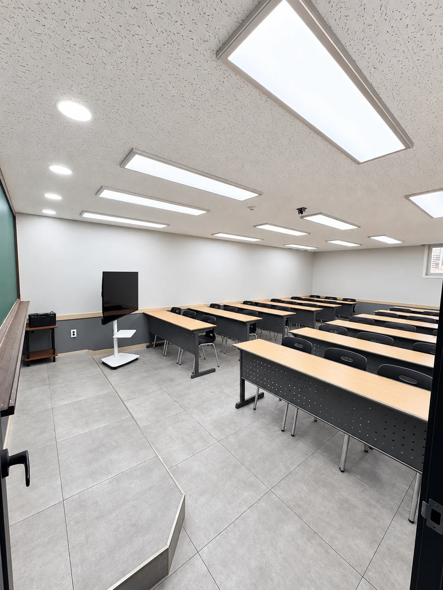
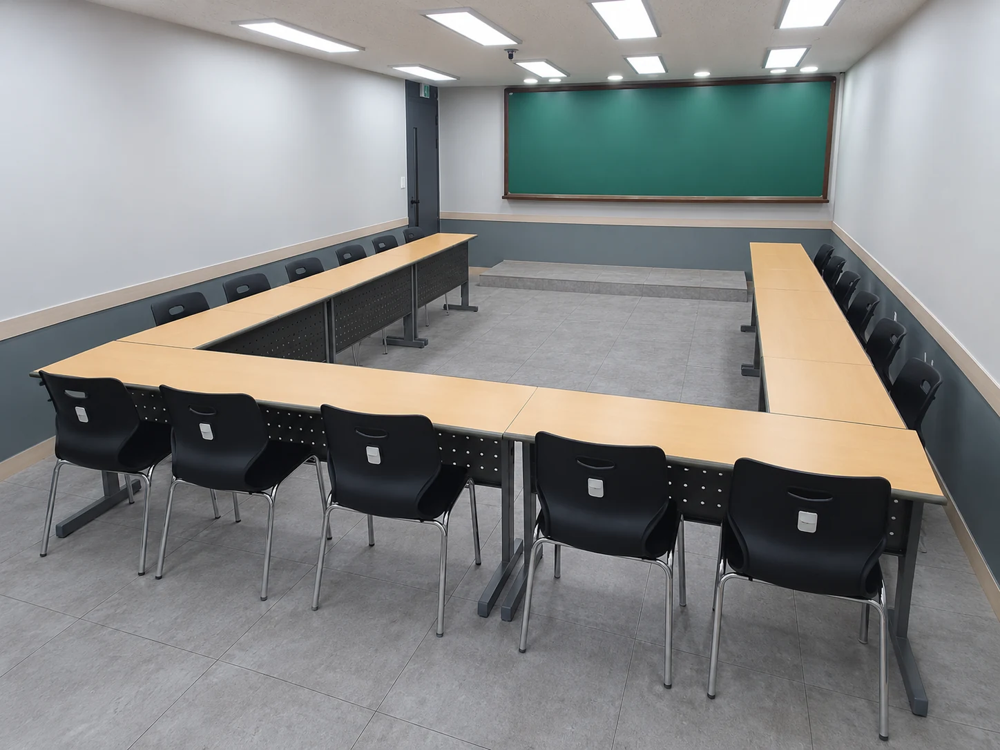

정기 수업을 여는 강사나 사내 교육을 맡은 담당자는 장소를 한 번만 고르지 않습니다. 4주 과정이면 네 번, 한 학기 과정이면 열 번 넘게 같은 방을 찾게 됩니다. 그래서 첫인상보다 매번 같은 배치와 장비로 수업을 시작할 수 있는지를 먼저 봐야 합니다. 지하철 2 · 7호선 건대입구역 도보권에 있는 소셜팩토리 건대의 세미나실 다섯 개 가운데, 1번룸은 이런 교육과 정기 클래스에 맞춘 방입니다.

## 숫자로 보는 1번룸

| 항목 | 내용 |
| --- | --- |
| 최대 인원 | {{rate.r1.max}}명 |
| 크기 | 8.02 × 4.47 m · 35.8㎡ (약 10.8평) |
| 천장 높이 | 2.32 m |
| 위치 | 4층 구역 D, 2번룸 옆 |
| 화면 · 판서 | 대형 모니터(이동식 거치대) · 칠판 |
| 기본 제공 | 와이파이 · 테이블 · 의자 · 냉난방 |
| 배치 | 책상 강의형 · ㄷ자 회의형 · 의자 강의형 · 조별형 |
| 시간당 요금 | 평일 {{rate.r1.wdEarly}}~{{rate.r1.wdStd}}원 · 주말 · 공휴일 {{rate.r1.hdEarly}}~{{rate.r1.hdStd}}원 |

요금은 부가세를 포함한 룸 단위 금액입니다. 최대 인원 안에서는 수강생이 몇 명이든 금액이 같습니다. 방 사진과 평면도 위치는 [공간 안내의 1번룸](/space#room-1)에서 볼 수 있습니다.

## 칠판은 정면에, 모니터는 수업에 맞춰 옮깁니다

1번룸은 정면에 칠판과 연단이, 뒤쪽에 창문과 냉난방기가 있는 직사각형 방입니다. 책상 강의형으로 놓으면 가운데 통로를 사이에 두고 양옆으로 책상이 늘어서서, 강사가 통로를 오가며 수강생 자리를 살피기 좋습니다.

대형 모니터는 이동식 거치대에 올려져 있어 배치에 맞춰 화면 위치를 정할 수 있습니다. 판서는 칠판에, 자료는 모니터에 나눠 두면 화면을 넘겨도 그날의 핵심이 칠판에 그대로 남습니다.

천장 높이는 2.32m입니다. 스크린을 크게 띄우고 30명 가까이 앞을 보는 강연이라면 천장이 3.12m인 [5번룸](/space#room-5)이 더 맞을 수 있습니다. 1번룸은 화면보다 칠판과 책상이 수업의 중심이 되는 자리에 어울립니다.

## 수업 방식에 따라 고르는 배치 네 가지

1번룸은 배치를 네 가지로 바꿔 씁니다. 수강생이 그 시간에 무엇을 하는지 떠올리면 고르기 쉽습니다.

| 배치 | 앉는 모습 | 어울리는 수업 |
| --- | --- | --- |
| 책상 강의형 | 중앙 통로 양옆으로 책상을 줄지어 정면을 봄 | 자격증 · 어학 강의, 필기와 노트북이 필요한 교육 |
| ㄷ자 회의형 | 책상을 ㄷ자로 두르고 칠판 쪽을 비움 | 토론 수업, 글쓰기 · 발표 피드백 클래스 |
| 의자 강의형 | 책상 없이 의자만 정면을 봄 | 짧은 특강, 과정 설명회 |
| 조별형 | 테이블을 모둠으로 나눔 | 팀 과제, 실습 수업, 원데이 공예 클래스 |

최대 {{rate.r1.max}}명은 이 방의 상한입니다. 책상을 쓰는 배치에서는 책상 수와 통로 폭에 따라 편하게 앉는 인원이 줄어듭니다. 의자 강의형은 책상이 없어 필기나 노트북을 쓰는 수업에는 맞지 않습니다. 배치는 이용자가 직접 바꾸고 퇴실 전에 원래대로 돌려놓으며, 배치별 사진은 [모임에 맞는 배치](/magazine/room-layout-types) 글에 모아 두었습니다.

## 매주 같은 방을 쓰면 준비가 줄어듭니다

같은 방을 이어 쓰면 아래 세 가지는 첫 회에 한 번 정해 두고 계속 쓸 수 있습니다.

1. **배치 그림.** 첫 회에 정한 배치를 사진으로 남겨 두면 다음 회차부터는 그대로 놓기만 하면 됩니다. 매번 원래대로 돌려놓는 방이라 준비 시간은 회차마다 예약에 넣습니다.
2. **화면 연결.** 노트북과 모니터를 잇는 방법을 첫 회에 확인해 두면 이후에는 연결 점검이 짧아집니다.
3. **수강생 안내.** 찾아오는 길과 입실 안내를 한 번 만들어 두고 회차마다 날짜만 바꿔 보냅니다. 언제 무엇을 보내면 좋은지는 [클래스 노쇼 줄이기](/magazine/class-no-show-reminder-messages) 글에 정리했습니다.

요일과 시간이 정해진 수업은 정기대관으로 따로 문의할 수 있습니다. 요일 · 시간, 이용 기간, 인원을 알려 주시면 이용 주기와 규모에 맞춘 조건을 안내해 드립니다.

## 회차 요금은 이렇게 계산합니다

1번룸 요금은 요일과 시간대로 정해집니다. 평일 07~12시와 24~07시는 시간당 {{rate.r1.wdEarly}}원, 평일 12~24시는 {{rate.r1.wdStd}}원입니다. 주말 · 공휴일은 같은 시간대에 각각 {{rate.r1.hdEarly}}원, {{rate.r1.hdStd}}원입니다. 예약은 최소 {{booking.minHours}}시간부터 30분 단위로 하고, 시간대에 걸친 수업은 구간마다 그 시간대 요금으로 계산합니다.

| 수업 | 예약 시간 (준비 포함) | 1회 금액 | 4회 합계 | 1인 1회 |
| --- | --- | --- | --- | --- |
| 평일 저녁 자격증 강의 20명 | 18:30~22:00 (3시간 30분) | {{= rate.r1.wdStd * 3.5 }}원 | {{= rate.r1.wdStd * 3.5 * 4 }}원 | {{= rate.r1.wdStd * 3.5 / 20 }}원 |
| 평일 오전 사내 교육 30명 | 09:00~12:00 (3시간) | {{= rate.r1.wdEarly * 3 }}원 | {{= rate.r1.wdEarly * 3 * 4 }}원 | {{= rate.r1.wdEarly * 3 / 30 }}원 |
| 평일 오전부터 점심까지 실습 15명 | 10:00~13:00 (3시간) | {{= rate.r1.wdEarly * 2 + rate.r1.wdStd }}원 | {{= (rate.r1.wdEarly * 2 + rate.r1.wdStd) * 4 }}원 | {{= (rate.r1.wdEarly * 2 + rate.r1.wdStd) / 15 }}원 |
| 토요일 오후 조별 클래스 16명 | 13:30~16:30 (3시간) | {{= rate.r1.hdStd * 3 }}원 | {{= rate.r1.hdStd * 3 * 4 }}원 | {{= rate.r1.hdStd * 3 / 16 }}원 |

세 번째 줄은 10~12시에 오전 요금, 12~13시에 오후 요금이 붙은 금액입니다. 표는 기본 요금 기준이고, 정기대관 조건은 문의하면 따로 안내합니다. 노트북이 필요하면 대당 {{cfg.pricing.options.0.price}}원에 빌릴 수 있고, 스피커와 전신거울은 무료로 빌려 드립니다. 날짜와 시간을 넣으면 [1번룸 예상 금액 계산](/pricing?room=r1#estimate)에서 시간대별 금액을 나눠 볼 수 있습니다.

## 예약 전에 확인할 네 가지

1. **인원은 강사와 보조 진행자까지 셉니다.** 룸마다 최대 인원이 있어 넘기면 이용이 중단될 수 있습니다. {{rate.r1.max}}명을 넘길 것 같다면 최대 {{rate.r2.max}}명인 2번룸이나 {{rate.r4.max}}명인 4번룸으로 바꿔 예약해 주세요.
2. **취소 기준을 과정 일정에 맞춰 봅니다.** 취소 · 환불 기준은 {{cfg.pricing.cancel}}입니다. 휴강이 생길 수 있는 과정이라면 회차 날짜를 일찍 확정해 두는 편이 안전합니다.
3. **저녁 수업은 끝나는 시각을 정해 둡니다.** 22시 이후에는 앰프를 쓸 수 없고, 23시 이후에는 조용한 이용만 가능합니다.
4. **다과는 되고 주류는 안 됩니다.** 음료 · 다과와 식사는 가져올 수 있지만, 건물이 교육환경보호구역 안에 있어 주류는 반입할 수 없습니다.

일정이 정해졌다면 [1번룸 예약 신청](/booking?room=r1)에서 날짜와 시간을 고르면 됩니다. 신청 뒤 시간 확보와 페이앱 결제를 거쳐 예약이 확정되고, 출입 방법은 문자나 메신저로 보내 드립니다. 매주 쓰실 계획이라면 [정기대관 문의](/contact?purpose=regular#inquiry)를 남겨 주세요. 더 작은 방이 필요하다면 룸 소개 첫 편인 [3번룸 글](/magazine/room-3-small-meeting-room)도 함께 보세요.
