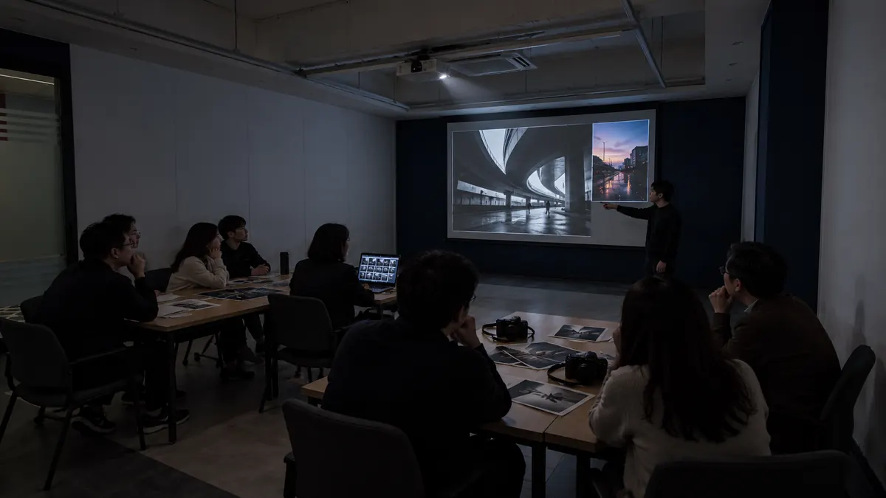

모임 장소를 정할 때 동네는 비교적 쉽게 합의됩니다. 지하철 2 · 7호선이 만나는 건대입구역은 여러 방향에서 오는 사람들이 고르기 무난한 곳입니다. 막히는 쪽은 그다음입니다. 카페로 갈지, 방을 빌릴지, 몇 명이 몇 시간 쓸지에 따라 맞는 곳이 완전히 달라지기 때문입니다.

건대입구역 주변에서 모임 장소를 찾는 분을 위해 장소 유형을 고르는 기준, 공공시설 예약 창구, 길 안내 공지 쓰는 법을 차례로 정리했습니다. 공공 정보는 공식 누리집에서 확인한 내용만 옮겼습니다.

## 건대입구역을 기준으로 잡으면 좋은 점

건대입구역은 2호선과 7호선이 만나는 환승역입니다. 두 노선 가까이에 사는 사람은 갈아타지 않고 오고, 다른 노선을 타는 사람도 둘 중 한 노선으로 갈아타면 닿습니다. 참석자가 서울 곳곳에 흩어져 있을 때 기준점으로 잡기 좋은 이유입니다.

다만 출구가 여럿인 환승역이라 '건대입구역에서 만나요'만 적으면 서로 다른 곳에서 기다리기 쉽습니다. 장소를 정했다면 건물 이름과 층까지 알려 주는 편이 좋습니다.

## 모임 성격별로 맞는 장소 유형

장소를 찾기 전에 이 모임이 무엇을 하는 자리인지 한 줄로 적어 보세요. 그 한 줄이 장소 유형을 정해 줍니다.

| 모임 | 맞는 장소 유형 | 먼저 확인할 것 |
| --- | --- | --- |
| 서너 명이 한두 시간 이야기 | 카페 | 자리 여유, 주변 소음 |
| 공공 목적 강좌 · 주민 모임 | 공공시설 대관 | 이용 대상, 신청 기간, 승인 절차 |
| 발표 · 강의 · 회의 | 시간 단위 세미나실 · 회의실 | 인원, 배치, 화면 장비, 요금 |
| 매주 같은 시간의 스터디 · 클래스 | 스터디룸 · 강의실 정기 대관 | 같은 시간 확보, 정기 이용 조건 |
| 혼자 또는 둘이 오래 공부 · 작업 | 코워킹 · 스터디카페 | 이용권 종류, 운영 시간 |
| 걷거나 바깥에서 하는 모임 | 공원 | 날씨, 공원 이용 규칙 |

화면을 띄우거나 책상이 필요한 모임이라면 카페보다 방을 빌리는 쪽이 낫습니다. 세미나실을 고를 때 인원보다 먼저 볼 점은 [건대입구 세미나실 고르는 법](/magazine/gundae-seminar-room-guide)에 따로 정리해 두었습니다.

## 공공시설 대관을 먼저 알아보려면

날짜에 여유가 있고 모임 목적이 시설의 이용 대상에 맞는다면 공공시설도 살펴볼 만합니다. 찾아볼 창구는 두 곳입니다.

- **서울시 공공서비스예약**(yeyak.seoul.go.kr): 서울시 산하기관과 25개 자치구가 제공하는 공공서비스를 온라인으로 예약 · 결제하는 곳입니다. 체육시설, 시설대관, 교육강좌, 문화행사 등으로 나뉘어 있고, 자치구별 '지역예약'으로도 찾아볼 수 있습니다.
- **공유누리**(www.eshare.go.kr): 중앙행정기관, 지방자치단체, 공공기관이 개방한 회의실, 강의실 · 강당 같은 자원을 예약하는 누리집입니다.

공공시설은 시설마다 이용 대상과 신청 시기, 사용료, 승인 여부가 다릅니다. 원하는 날짜보다 넉넉히 앞서 조건을 확인하세요. 반대로 이번 주 안에 바로 잡아야 하거나 밤늦게 모여야 한다면, 시간 단위로 예약하는 대관 공간을 함께 비교해 보면 됩니다.

## 헤매지 않는 길 안내 공지 쓰는 법

장소가 정해지면 공지 한 번으로 모두를 같은 문 앞에 세우는 일이 남습니다. 아래 여섯 가지를 차례로 적어 보세요.

1. **건물 이름과 층까지** 적습니다. 소셜팩토리 건대라면 '서울 광진구 화양동 10-1 한아름건물 4층'입니다.
2. **지도 링크**를 붙입니다. 네이버 지도나 카카오맵 링크가 있으면 각자 검색하지 않고 바로 길 찾기로 넘어갑니다.
3. **출구 번호는 직접 확인한 것만** 적습니다. 처음 가는 곳이라면 '건대입구역 도보권'처럼 범위만 적고 지도 링크에 맡기는 편이 안전합니다.
4. **주차 정보**를 따로 둡니다. 소셜팩토리 건대는 건물 주차권 요금과 구매 방법, 근처 공영주차장 정보를 [주차 안내](/parking)에 모아 두었습니다.
5. **먼저 온 사람이 기다릴 곳**을 정합니다. 소셜팩토리 건대에서는 입실 시간 전에 도착하면 4층 휴게 · 대기 공간에서 기다리면 됩니다.
6. **끝나는 시각**도 적습니다. 저녁 모임이라면 막차가 역과 방향마다 다르니 미리 확인해 두자는 한 줄을 덧붙이세요.

건물 입구에서 4층으로 올라오면 복도 입구에 소셜팩토리 안내가 있고, 출입 방법은 예약 시간에 맞춰 문자나 메신저로 보내 드립니다. 무인 예약제 공간이 처음이라면 [무인 예약제 공간을 처음 쓸 때 알아 둘 것](/magazine/unmanned-space-first-visit)도 함께 읽어 보세요.

## 모임 전후로 걸을 곳이 필요하다면

걷기 모임이나 사진 동호회 출사처럼 바깥 활동이 들어가는 모임이라면 가까운 공원을 함께 떠올려 볼 수 있습니다. 서울어린이대공원은 광진구 능동로 216에 있습니다. 서울시설공단 안내에 따르면 7호선 어린이대공원역에서는 정문으로, 5호선 아차산역에서는 후문으로 들어가고, 2호선 건대입구역에서는 버스나 7호선 환승으로 가는 길을 안내합니다. 운영 시간과 이용 규칙은 공원 누리집에서 확인하세요.

걷고 찍은 뒤 실내로 옮겨, 빔프로젝터가 있는 방에서 사진을 한 장씩 띄워 보며 이야기하는 순서도 괜찮습니다.

## 실내에서 모인다면, 소셜팩토리 건대

소셜팩토리 건대는 화양동 한아름건물 4층에 최대 {{stat.minCap}}명부터 {{stat.maxCap}}명까지 쓰는 룸 다섯 개와 24시간 코워킹, 독립사무실을 함께 두고 있습니다. 회의와 스터디는 3번룸({{rate.r3.max}}명), 강연과 상영은 5번룸({{rate.r5.max}}명), 조별 워크숍은 4번룸({{rate.r4.max}}명)부터 보면 됩니다. 요금은 인원이 아니라 룸과 시간으로 정해지며 시간당 {{stat.from}}원부터입니다.

룸은 24시간 예약제라 퇴근 후 늦게 시작하는 모임도 잡을 수 있습니다. 다만 22시 이후에는 앰프를 쓸 수 없고, 23시 이후에는 조용한 이용만 가능합니다. 예약은 최소 {{booking.minHours}}시간부터이며 준비와 정리 시간까지 넣어 잡습니다. 음료 · 다과와 식사는 가져올 수 있지만, 건물이 교육환경보호구역 안에 있어 주류는 반입할 수 없습니다.

방별 크기와 사진은 [공간 안내](/space#rooms)에서, 날짜와 시간대별 금액은 [예상 금액 계산](/pricing#estimate)에서 바로 볼 수 있습니다. 날짜와 인원이 정해졌다면 [예약 신청](/booking)으로, 어떤 방이 맞을지 고민된다면 일자 · 시간 · 인원 · 모임 유형을 [문의](/contact)로 남겨 주세요.

---

**참고한 공식 안내**

- [서울시설공단 · 서울어린이대공원 찾아오시는 길](https://sisul.or.kr/open_content/childrenpark/introduce/location.jsp)
- [내 손안에 서울 · '서울시 공공서비스 예약' 개편 (2021년 3월)](https://mediahub.seoul.go.kr/archives/2000926)
- [대한민국 정책브리핑 · 전국 공공개방자원 활용하기 (2024년 7월)](https://www.korea.kr/multi/visualNewsView.do?newsId=148931317)
