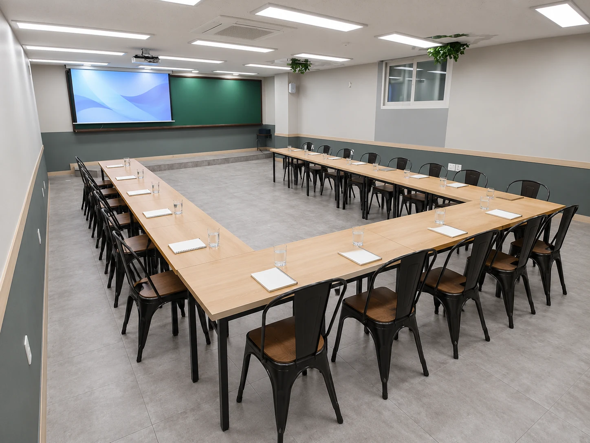

세미나실을 예약할 때 가장 먼저 떠올리는 건 모임 시간입니다. 강의가 두 시간이면 두 시간, 회의가 한 시간 반이면 한 시간 반을 잡습니다. 그런데 실제로 방을 쓰는 시간은 그보다 깁니다. 들어가서 책상을 맞추고 노트북을 연결하는 시간, 끝난 뒤 의자를 돌려놓고 쓰레기를 정리하는 시간이 앞뒤로 붙습니다.

이 앞뒤 시간을 얼마나 잡느냐에 따라 당일의 여유도, 대관료도 달라집니다. 건대입구에서 세미나실이나 스터디룸을 빌리는 분을 위해, 배치와 준비물에 따라 준비 · 정리 시간을 가늠하는 법을 소셜팩토리 건대 기준으로 정리했습니다.

## 예약 시간은 준비, 모임, 정리를 더한 값입니다

소셜팩토리 건대는 상주 직원 없이 운영합니다. 배치는 이용자가 직접 바꾸고, 퇴실 전에 원래대로 돌려놓습니다. 준비와 정리 모두 예약한 시간 안에서 이용자가 하는 일입니다.

입실할 수 있는 시각은 예약 안내 메시지에 적혀 있고, 먼저 도착한 사람은 4층 휴게 · 대기 공간에서 기다리면 됩니다. 예약 시작을 모임 시작 시각과 똑같이 잡으면, 참석자가 들어오는 동안 책상을 옮기고 화면을 연결하게 됩니다. 첫 10분이 어수선해지는 이유가 대개 여기에 있습니다.

[예약 신청](/booking) 화면에서도 준비 · 정리 시간을 포함해 시작과 끝을 고르도록 안내합니다. 모임 시간을 먼저 적고, 앞에 준비 시간을, 뒤에 정리 시간을 붙여 보세요.

## 준비 시간을 늘리는 네 가지

준비 시간은 방 크기보다 그날 할 일의 가짓수에 따라 늘어납니다. 아래 네 가지 중 몇 개가 해당하는지 먼저 세어 보세요.

1. **배치 바꾸기.** 들어갔을 때 놓인 배치를 그대로 쓰면 시간이 거의 들지 않습니다. 책상을 한쪽으로 빼거나 모둠으로 나누면 옮길 가구 수만큼 늘어납니다.
2. **화면 연결.** 2 · 4 · 5번룸에는 빔프로젝터, 1 · 3번룸에는 대형 모니터가 있습니다. 방 안 QR을 찍으면 연결 방법이 나오지만, 발표 자료를 띄워 글씨 크기와 소리까지 확인하려면 몇 분이 더 듭니다.
3. **자료와 접수.** 인쇄물을 자리마다 놓거나, 입구 쪽에 명찰과 출석표를 둘 책상을 따로 차리면 그만큼 더 잡습니다.
4. **다과와 식사.** 음료 · 다과와 식사는 가져올 수 있고, 같은 건물 밍글카페와 제휴해 준비할 수도 있습니다. 음식을 차린 모임은 테이블을 닦고 쓰레기를 모으는 일이 더해지니 정리 시간 쪽에 여유를 둡니다.

## 배치별 준비 · 정리 시간 예시

아래 표는 처음 예약할 때 출발점으로 삼을 만한 예시입니다. 직접 잰 평균이 아니라 옮길 가구의 양을 기준으로 잡은 값이라, 인원이 많거나 손을 보탤 사람이 적으면 늘리고 여럿이 함께 옮기면 줄이면 됩니다.

| 그날의 배치 | 준비 | 정리 | 어울리는 모임 |
| --- | --- | --- | --- |
| 놓인 배치 그대로, 화면 연결만 | 15분 | 15분 | 회의, 스터디, 짧은 발표 |
| 놓인 배치에서 책상 몇 개만 옮기기 | 20~30분 | 15~20분 | 소규모 강의, 면접 연습 |
| 책상 강의형을 회의형으로 | 30분 | 30분 | 토론, ㄷ자 회의 |
| 책상을 빼고 의자 강의형으로 | 30분 | 30분 | 강연, 설명회, 상영 |
| 조별형 · 자유 배치 | 30~45분 | 30분 | 워크숍, 조별 활동, 네트워킹 |

방마다 안내하는 배치도 다릅니다. 3번룸은 책상 강의형과 회의형, 5번룸은 의자 강의형 · 책상 강의형 · ㄷ자 회의형을 안내합니다. 조별형은 1번룸과 4번룸에서 가능하고, 가장 넓은 4번룸은 다섯 가지 배치를 모두 쓸 수 있습니다.

예약은 {{booking.stepMinutes}}분 단위라, 모임 시간에 준비와 정리를 더한 뒤 그 단위로 올려 잡습니다. 두 시간짜리 워크숍에 준비 45분, 정리 30분이면 3시간 15분이니 3시간 30분으로 예약하는 식입니다. 남는 15분은 마지막 참석자가 짐을 챙겨 나가는 시간이 되어 줍니다.

## 준비와 정리를 줄이는 요령

- **예약할 때 배치를 말해 두세요.** 원하는 배치를 알려 주시면 예약 전에 가능 여부를 안내해 드립니다. 방에 들어가서 고민하는 시간이 줄어듭니다.
- **들어가자마자 사진 한 장.** 처음 배치를 찍어 두면 정리할 때 사진대로 돌려놓기만 하면 됩니다.
- **배치 그림을 미리 그려 오세요.** 책상 위치를 종이에 그려 오면 여럿이 나눠 옮기기 쉽습니다. 배치별 사진은 [모임에 맞는 배치 5가지](/magazine/room-layout-types)에 모아 두었습니다.
- **마지막 10분은 다 같이.** 끝인사 전에 각자 앉은 의자만 제자리에 놓아 달라고 부탁하면 정리가 금방 끝납니다. 방 안 QR의 퇴실 전 확인 목록은 마지막 사람이 한 번 훑고 나오면 됩니다.

## 앞뒤 30분은 대관료로 얼마일까

룸 요금은 인원이 아니라 방과 시간으로 정해집니다. 평일 저녁에 2번룸에서 두 시간 강연을 연다고 하면, 준비 · 정리 시간에 따라 금액이 이렇게 달라집니다.

- 모임 시간만 2시간: {{= rate.r2.wdStd * 2 }}원
- 앞뒤 15분씩 더해 2시간 30분: {{= rate.r2.wdStd * 2.5 }}원
- 의자 강의형으로 바꾸고 앞뒤 30분씩 더해 3시간: {{= rate.r2.wdStd * 3 }}원

30분을 더 잡는 비용은 이 경우 {{= rate.r2.wdStd / 2 }}원입니다. 모임 시간만 예약하면 가장 싸 보이지만, 준비가 모임 안으로 밀려 들어와 첫 순서가 늦어집니다.

시간대를 활용하는 방법도 있습니다. 07~12시는 낮은 요금이라, 12시 30분에 시작하는 세미나의 준비를 11시 30분부터 잡으면 앞의 30분은 오전 요금으로 계산됩니다. 2번룸 평일이라면 그 30분이 {{= rate.r2.wdEarly / 2 }}원입니다. 시간대가 걸칠 때 계산하는 법은 [시간대마다 요금이 다른 이유](/magazine/room-rate-by-time)에 정리해 두었습니다. 최소 예약은 {{booking.minHours}}시간이라, 한 시간 반짜리 회의라면 앞뒤 15분씩 더해도 최소 시간 안에 들어갑니다.

## 정리가 늦어질 것 같을 때

연장은 다음 예약이 없을 때 가능하며, 연장한 시간에는 그 시간대 요금이 적용됩니다. 예약 시간을 넘길 것 같으면 미리 알려 주세요. 바로 뒤에 다른 예약이 있으면 연장할 수 없으니, 정리 시간은 처음부터 예약에 넣어 두는 편이 안전합니다.

반대로 더 일찍 들어가 준비하고 싶다면 바로 앞 시간이 비어 있을 때 그 시간을 더해 예약하면 됩니다. 이때도 그 시간대 요금이 적용됩니다.

방별 크기와 배치 사진은 [공간 안내](/space#layouts)에서, 날짜와 시간대별 금액은 [예상 금액 계산](/pricing#estimate)에서 바로 확인할 수 있습니다. 일정이 정해졌다면 [예약 신청](/booking)으로, 원하는 배치가 되는지 궁금하다면 일자 · 시간 · 인원 · 모임 유형과 배치를 [문의](/contact)로 남겨 주세요. 예약 전부터 퇴실까지 확인할 것은 [강의실 대관 체크리스트](/magazine/lecture-room-rental-checklist)에 모아 두었습니다.
