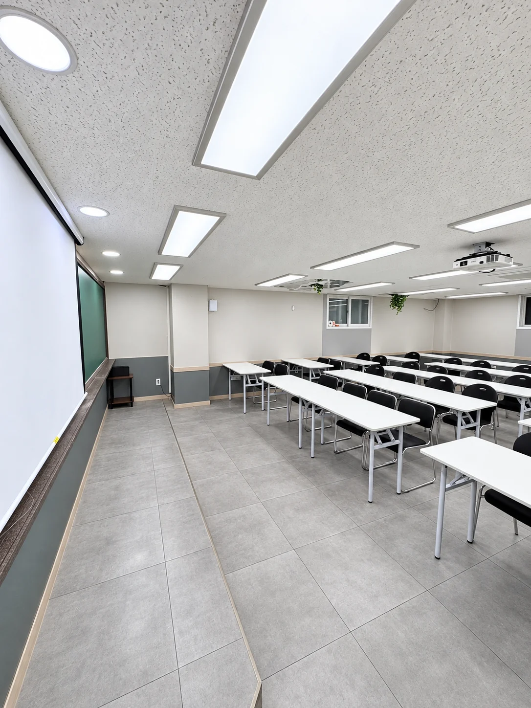
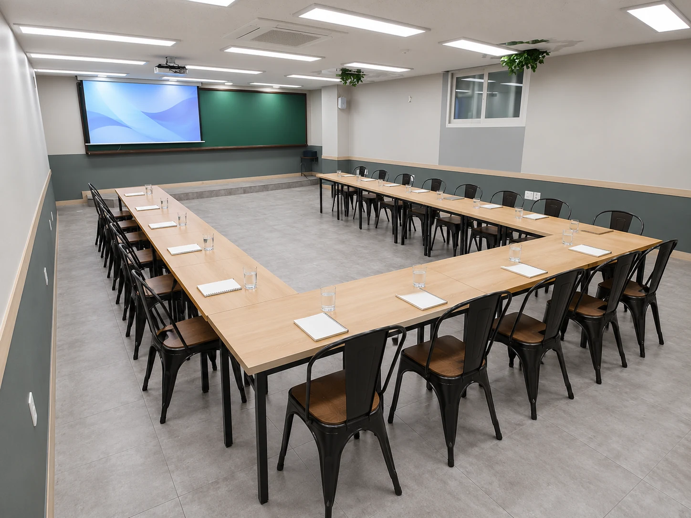

외부 강사를 모시는 특강, 연말 성과 공유회, 새 서비스 설명회처럼 서른 명 넘게 한 방향을 보고 듣는 자리는 장소에서 확인할 것이 분명합니다. 뒷줄까지 화면이 보이는지, 모두 앉고도 통로가 남는지입니다. 지하철 2 · 7호선 건대입구역 도보권에 있는 소셜팩토리 건대의 룸 다섯 개 가운데 2번룸이 이런 자리를 위한 방입니다.

## 숫자로 보는 2번룸

| 항목 | 내용 |
| --- | --- |
| 최대 인원 | {{rate.r2.max}}명 |
| 크기 | 9.16 × 5.69 m · 52.1㎡ (약 15.8평) |
| 천장 높이 | 2.32 m |
| 위치 | 4층 구역 C, 1번룸 옆 |
| 화면 · 판서 | 빔프로젝터 · 칠판 |
| 기본 제공 | 와이파이 · 테이블 · 의자 · 냉난방 |
| 배치 | 의자 강의형 · 책상 강의형 · ㄷ자 회의형 · 자유 배치 |
| 시간당 요금 | 평일 {{rate.r2.wdEarly}}~{{rate.r2.wdStd}}원 · 주말 · 공휴일 {{rate.r2.hdEarly}}~{{rate.r2.hdStd}}원 |

요금은 부가세를 포함한 룸 단위 금액이라, 최대 인원 안에서는 몇 명이 와도 같습니다. 최대 인원으로 나누면 1인당 시간당 약 {{= rate.r2.wdEarly / rate.r2.max }}~{{= rate.r2.hdStd / rate.r2.max }}원입니다. 방 사진과 평면도 위치는 [공간 안내의 2번룸](/space#room-2)에서 볼 수 있습니다.

## 스크린과 칠판이 한쪽 벽에 모여 있습니다

2번룸은 가로 9.16m, 세로 5.69m의 직사각형 방입니다. 빔프로젝터는 천장에 달려 있고, 스크린은 칠판과 같은 벽에 나란히 있습니다. 슬라이드는 스크린에 띄우고 그날의 순서나 받은 질문은 칠판에 적어 두면, 화면을 넘겨도 핵심이 벽에 남습니다.

[4층 평면도](/space#floorplan)로 보면 복도 끝 왼쪽, 3번룸 아래에 있고 1번룸과 붙어 있습니다. 스크린을 더 높이 걸고 싶은 상영회나 서른 명 안팎의 강연이라면 천장이 3.12m인 [5번룸](/space#room-5)도 함께 견줘 보세요. 2번룸은 5번룸보다 바닥이 넓고 최대 인원도 많아서, 서른 명을 넘기거나 책상을 놓고 듣는 세미나에 더 맞습니다.

## 듣는 방식에 맞춰 고르는 배치 네 가지

참석자가 그 시간에 듣기만 하는지, 적거나 노트북을 쓰는지, 서로 이야기하는지를 떠올리면 배치를 고르기 쉽습니다.

| 배치 | 앉는 모습 | 어울리는 자리 |
| --- | --- | --- |
| 의자 강의형 | 책상 없이 의자만 스크린 쪽을 봄 | 초청 특강, 설명회, 북토크 |
| 책상 강의형 | 중앙 통로 양옆으로 책상을 줄지어 놓음 | 기업 교육, 노트북을 쓰는 세미나 |
| ㄷ자 회의형 | 책상을 ㄷ자로 두르고 스크린 쪽을 비움 | 패널 토론, 발표 뒤 의견을 나누는 세미나 |
| 자유 배치 | 가구를 옮겨 가운데에 활동 공간을 만듦 | 네트워킹, 쉬는 시간이 긴 행사 |

최대 {{rate.r2.max}}명은 이 방의 상한입니다. 책상을 놓는 배치에서는 책상 수와 통로 폭만큼 편하게 앉는 인원이 줄어듭니다. 최대 인원에 가깝게 모이는 강연이라면 책상 없는 의자 강의형이 자리를 덜 차지합니다. 조별로 테이블을 나눠 오래 활동하는 워크숍이라면 조별형 배치가 되는 [4번룸](/space#room-4)을 보세요. 배치는 이용자가 직접 바꾸고 퇴실 전에 원래대로 돌려놓습니다.

## 두 시간 강연이면 예약은 세 시간으로 잡습니다

인원이 많은 행사일수록 시작 전에 할 일이 많습니다. 배치를 바꾸고, 슬라이드를 띄워 보고, 들어오는 사람을 맞을 자리도 만들어야 합니다. 본 행사가 두 시간이라면 예약은 세 시간으로 잡고 아래처럼 나누면 여유가 생깁니다.

1. **첫 30분, 준비.** 배치를 바꾸고 첫 슬라이드와 영상 소리를 확인합니다. 와이파이 이름과 비밀번호는 방 안에 붙은 QR로 볼 수 있습니다.
2. **가운데 2시간, 본 행사.** 강연 90분과 질의응답 30분처럼 미리 나눠 두면 끝나는 시각이 밀리지 않습니다.
3. **마지막 30분, 정리.** 배치를 원래대로 돌려놓고 쓰레기를 치운 뒤 퇴실합니다.

영상 소리를 방 전체에 들려줘야 한다면 무료로 빌려 드리는 스피커를 함께 신청해 두세요. 연장은 다음 예약이 없을 때만 가능합니다. 배치별 준비 시간은 [세미나실 준비 시간과 정리 시간](/magazine/setup-cleanup-time-by-layout) 글에 표로 정리했습니다.

## 같은 세 시간, 시간대별 요금 계산

2번룸 요금은 요일과 시간대로 정해집니다. 평일 07~12시와 24~07시는 시간당 {{rate.r2.wdEarly}}원, 12~24시는 {{rate.r2.wdStd}}원입니다. 주말 · 공휴일은 같은 시간대에 각각 {{rate.r2.hdEarly}}원, {{rate.r2.hdStd}}원입니다. 예약은 최소 {{booking.minHours}}시간부터 30분 단위로 하고, 시간대에 걸친 예약은 구간마다 그 시간대 요금으로 계산합니다.

| 행사 | 예약 시간 | 3시간 금액 | {{rate.r2.max}}명일 때 1인 |
| --- | --- | --- | --- |
| 평일 오전 사내 세미나 | 09:00~12:00 | {{= rate.r2.wdEarly * 3 }}원 | {{= rate.r2.wdEarly * 3 / rate.r2.max }}원 |
| 평일 점심에 걸친 설명회 | 10:30~13:30 | {{= rate.r2.wdEarly * 1.5 + rate.r2.wdStd * 1.5 }}원 | {{= (rate.r2.wdEarly * 1.5 + rate.r2.wdStd * 1.5) / rate.r2.max }}원 |
| 평일 저녁 초청 특강 | 19:00~22:00 | {{= rate.r2.wdStd * 3 }}원 | {{= rate.r2.wdStd * 3 / rate.r2.max }}원 |
| 토요일 오전 교육 | 09:00~12:00 | {{= rate.r2.hdEarly * 3 }}원 | {{= rate.r2.hdEarly * 3 / rate.r2.max }}원 |
| 토요일 오후 공개 강연 | 14:00~17:00 | {{= rate.r2.hdStd * 3 }}원 | {{= rate.r2.hdStd * 3 / rate.r2.max }}원 |

같은 세 시간이라도 평일 오전과 토요일 오후는 {{= (rate.r2.hdStd - rate.r2.wdEarly) * 3 }}원 차이가 납니다. 참석자가 근무 시간에 오는 사내 행사라면 평일 오전이 비용을 줄이는 쉬운 방법입니다. 노트북이 필요하면 대당 {{cfg.pricing.options.0.price}}원에 빌릴 수 있습니다. 날짜와 시간을 넣으면 [2번룸 예상 금액 계산](/pricing?room=r2#estimate)에서 시간대별 금액을 나눠 볼 수 있습니다.

## 예약 전에 확인할 네 가지

1. **인원은 연사와 진행자까지 셉니다.** 최대 인원을 넘기면 이용이 중단될 수 있습니다. {{rate.r2.max}}명을 넘길 것 같다면 최대 {{rate.r4.max}}명인 4번룸으로 바꾸거나, [방을 나눠 쓰는 큰 행사](/magazine/large-event-over-48) 글을 참고해 주세요.
2. **취소 기준을 공지 전에 봅니다.** 취소 · 환불 기준은 {{cfg.pricing.cancel}}입니다. 연사 일정이 바뀔 수 있다면 날짜를 확정한 뒤 예약하는 편이 안전합니다.
3. **저녁 행사는 끝나는 시각을 정해 둡니다.** 22시 이후에는 앰프를 쓸 수 없고, 23시 이후에는 조용한 이용만 가능합니다.
4. **다과는 되고 주류는 안 됩니다.** 음료 · 다과와 식사는 가져올 수 있고, 같은 건물 밍글카페와 제휴해 준비할 수도 있습니다. 건물이 교육환경보호구역 안에 있어 주류는 반입할 수 없습니다.

날짜가 정해졌다면 [2번룸 예약 신청](/booking?room=r2)에서 날짜와 시간을 고르면 됩니다. 신청 뒤 시간 확보와 페이앱 결제를 거쳐 예약이 확정되고, 출입 방법은 확정 뒤 안내해 드립니다. 옆방 1번룸까지 함께 써서 분과 세션을 열고 싶다면 진행 방식과 동선을 [문의](/contact)로 먼저 상담해 주세요. 정기 수업에 맞춘 방은 룸 소개 두 번째 편인 [1번룸 글](/magazine/room-1-regular-class-room)에 정리했습니다.
